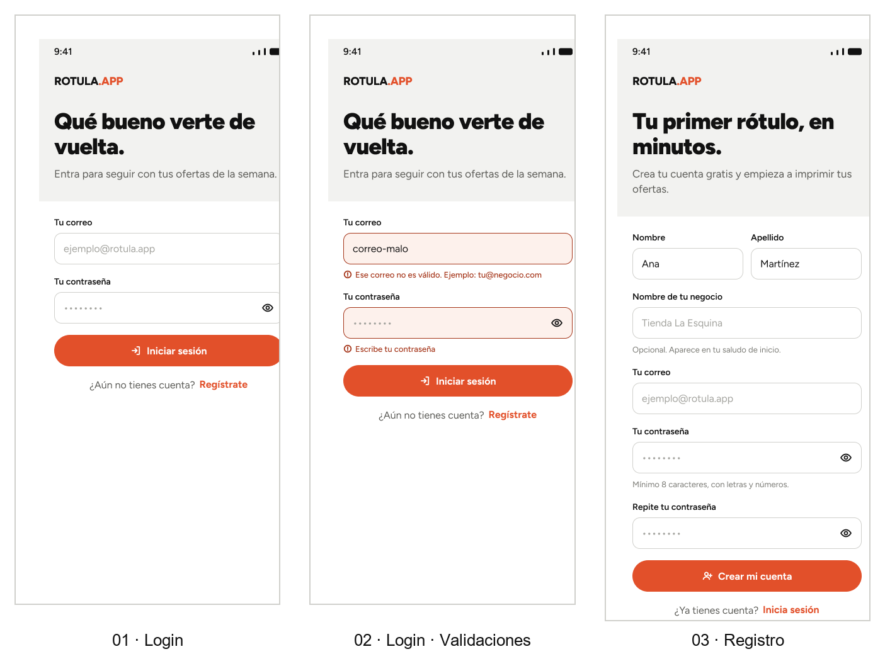
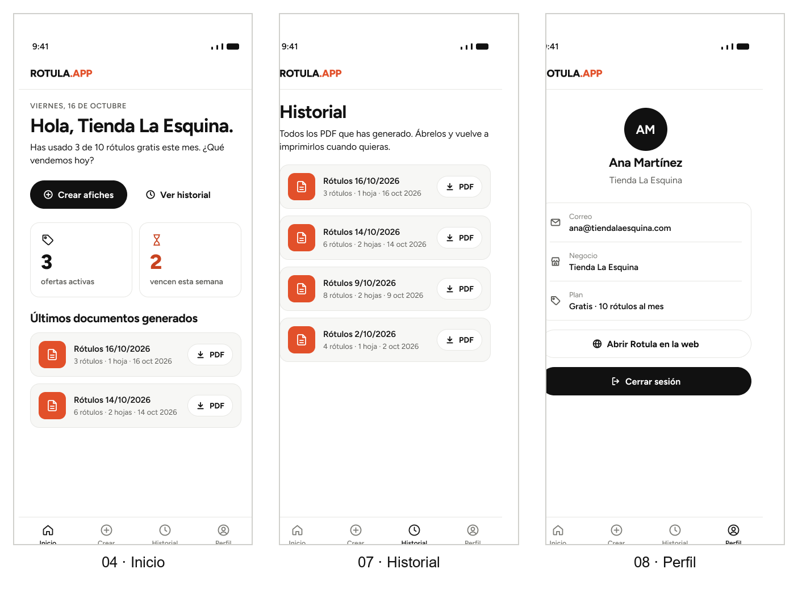
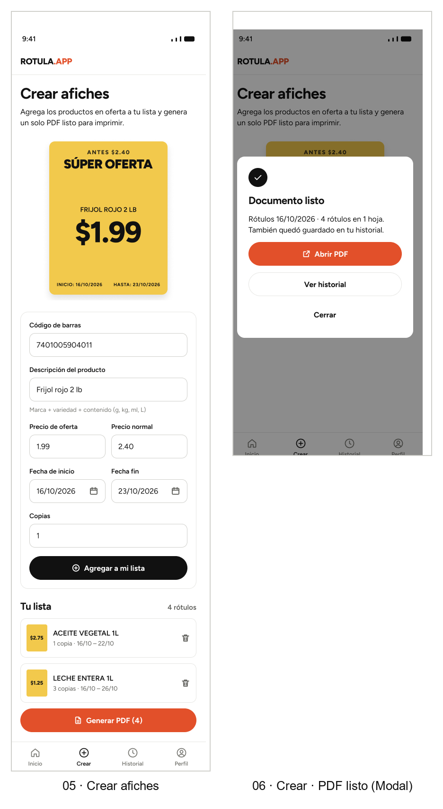
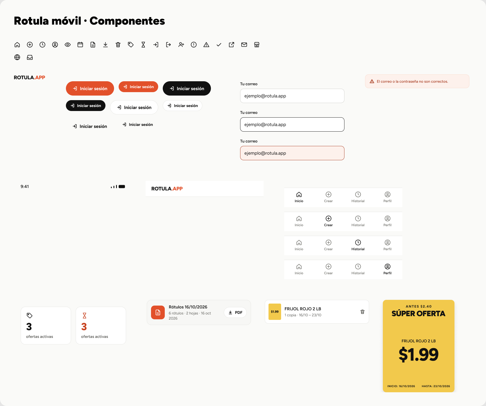
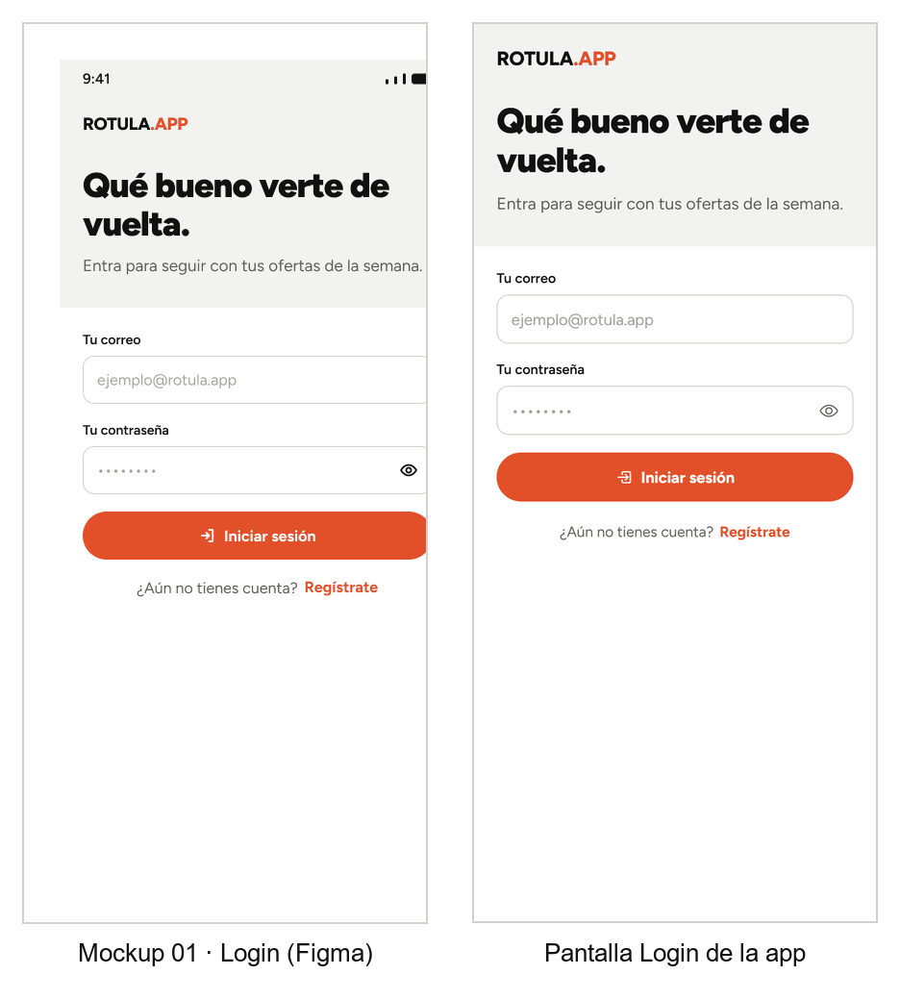

# Rotula — Afiches de ofertas en minutos (web + móvil)

[](LICENSE)


**Universidad Don Bosco · DPS941 Diseño y Programación de Software Multiplataforma · Grupo G01T**
**Etapa 3: Entrega final del proyecto multiplataforma** · Ciclo 02-2026 · Docente: Ing. Alexander Alberto Siguenza Campos

| | |
|---|---|
| **Repositorio (web + móvil)** | https://github.com/Slincker5/rotula |
| **Versión web en Vercel** | https://rotula.vercel.app |
| **Versión móvil** | Carpeta [`movil/`](movil/) de este repositorio (Expo + React Native) |
| **Fecha de entrega** | Domingo 22 de noviembre de 2026 |

Todo el proyecto está en este repositorio: la web (Next.js) en la raíz y la app móvil (React Native) en `movil/`,
con su historial de commits completo. Los mockups de Figma, la documentación y la licencia también están aquí.

---

## Contenido

1. [Integrantes](#1-integrantes)
2. [Descripción del proyecto](#2-descripción-del-proyecto)
3. [Cumplimiento de la entrega final](#3-cumplimiento-de-la-entrega-final)
4. [Arquitectura multiplataforma](#4-arquitectura-multiplataforma)
5. [Stack tecnológico](#5-stack-tecnológico)
6. [Autenticación](#6-autenticación)
7. [Módulos](#7-módulos)
8. [Datos compartidos en Firestore](#8-datos-compartidos-en-firestore)
9. [Mockups de Figma (Etapa 1)](#9-mockups-de-figma-etapa-1)
10. [Instalación y ejecución](#10-instalación-y-ejecución)
11. [Despliegue en Vercel](#11-despliegue-en-vercel)
12. [Flujo de trabajo con Git](#12-flujo-de-trabajo-con-git)
13. [Licencia](#13-licencia)

---

## 1. Integrantes

| # | Nombre completo | Carné | Usuario de GitHub | Ramas de trabajo | Aporte principal |
|---|---|---|---|---|---|
| 1 | Gerson Vladimir Borja Álvarez | BA251704 | [@Slincker5](https://github.com/Slincker5) | `vladi-parte`, `dev` (web) · `feature/base-y-acceso` (móvil) | Backend y lógica del PDF, base de la app móvil (tema, componentes, sesión, login, registro, perfil, navegación), development build con Google y migración final de la web a Firestore |
| 2 | Ariel Alexander Hernández Merino | HM251962 | [@Hernan-byte](https://github.com/Hernan-byte) | `ariel-parte`, `feature/rol-admin-ariel`, `feature/home` (web) · `feature/afiches-e-historial`, `feature/firebase` (móvil) | Frontend web, módulo admin, Firebase Authentication en la web, pantallas de afiches, historial e inicio en el móvil e integración de Firebase en la app |

Los dos integrantes son colaboradores del repositorio y tienen commits en la web y en la app móvil.

---

## 2. Descripción del proyecto

**Rotula** es una solución multiplataforma para dueños y encargados de tiendas, minisúper y supermercados. Permite
registrar **rótulos de oferta** (afiches de precio) y generar un **PDF listo para imprimir** con cuatro rótulos por hoja A4,
con marcas de corte.

Cada rótulo lleva la descripción del producto, el precio de oferta en grande, el precio normal tachado con el ahorro
calculado, la vigencia (fecha de inicio y fin) y el código de barras EAN. El usuario los agrega a una lista, elige
cuántas copias necesita y con un clic genera el documento. Puede hacerlo desde la computadora (web) o desde el
celular (app), con la misma cuenta y los mismos datos.

### Problema que resuelve (Etapa 1)

En los comercios pequeños los rótulos de precio se hacen a mano o en Word: sin formato uniforme, sin control de
vigencia y sin registro de lo que se imprimió. Rotula centraliza esa información, estandariza el diseño y deja historial.

---

## 3. Cumplimiento de la entrega final

| # | Requerimiento | Cómo se cumple | Dónde verlo |
|---|---|---|---|
| 1 | Versión web en React + Next.js desplegada en Vercel | Next.js 16 (App Router) + React 19, desplegada en https://rotula.vercel.app | Raíz del repo: `app/`, `components/`, `lib/` |
| 2 | Versión móvil en React Native con Firebase | Expo SDK 58 + React Native con Firebase JS SDK (Auth + Firestore) | [`movil/`](movil/) |
| 3 | Autenticación con correo y redes sociales en ambas plataformas | Firebase Authentication: correo/contraseña y **Google** en web (popup) y móvil (Google Sign-In nativo) | Web: `components/Sesion.jsx`, `components/BotonGoogle.jsx` · Móvil: `movil/src/contexto/Sesion.js`, `movil/src/firebase/google.js` |
| 4 | Módulos principales y secundarios funcionales | Principales: crear afiches, generar PDF, historial e inicio. Secundarios: mis productos, perfil y administración | [Sección 7](#7-módulos) |
| 5 | Persistencia en Firestore compartida entre web y móvil | Las dos apps usan el **mismo proyecto de Firebase** y la misma estructura `usuarios/{uid}/...` | Web: `lib/rotulos.js`, `lib/productos.js` · Móvil: `movil/src/firebase/` · Reglas: `movil/firestore.rules` |
| 6 | Diseño UX/UI coherente con los mockups de Figma | Mismos colores, tipografía Figtree, botones en píldora y estructura de pantallas en web y móvil | [Sección 9](#9-mockups-de-figma-etapa-1) |
| 7 | Mockups publicados en el README | Imágenes de Figma dentro del repositorio (`movil/docs/figuras/`) | [Sección 9](#9-mockups-de-figma-etapa-1) |
| 8 | Licencia Creative Commons | **CC BY-NC-SA 4.0** | [`LICENSE`](LICENSE), [sección 13](#13-licencia) |
| 9 | Repositorio GitHub con rama por alumno, colaboradores y README | Ramas por integrante, integración por Pull Request y este README | [Sección 12](#12-flujo-de-trabajo-con-git) |
| 10 | Propuesta original | Código y diseño propios del grupo | Historial de commits |

---

## 4. Arquitectura multiplataforma

```
                ┌──────────────────────────┐         ┌──────────────────────────┐
                │  WEB  (raíz del repo)    │         │  MÓVIL  (movil/)         │
                │  Next.js 16 + React 19   │         │  Expo + React Native     │
                │  Tailwind CSS · Vercel   │         │  React Navigation        │
                │  pdf-lib en el navegador │         │  pdf-lib en el celular   │
                └────────────┬─────────────┘         └────────────┬─────────────┘
                             │   Firebase JS SDK (mismo proyecto)  │
                             └───────────────┬─────────────────────┘
                                             ▼
                        ┌─────────────────────────────────────────────┐
                        │  FIREBASE (proyecto rotula-web)             │
                        │  Authentication: correo + Google            │
                        │  Firestore: usuarios/{uid}/rotulos          │
                        │             usuarios/{uid}/documentos       │
                        │             usuarios/{uid}/productos        │
                        │  Reglas de seguridad: movil/firestore.rules │
                        └─────────────────────────────────────────────┘
```

- **Sin servidor propio:** las dos apps hablan directo con Firebase. La seguridad la ponen las reglas de Firestore
  (cada usuario solo lee y escribe lo suyo, y se validan los datos).
- **El PDF no se guarda en ningún lado:** se pinta con `pdf-lib` en el navegador o en el celular a partir de los rótulos
  guardados. Por eso un documento se puede volver a descargar desde cualquiera de las dos plataformas.
- **Mismo código de negocio:** el generador del PDF (`lib/pdf/` en la web y `movil/src/pdf/` en el móvil) y las
  validaciones son los mismos en las dos apps.

### Estructura del repositorio

```
rotula/
├── app/                        # WEB (Next.js App Router)
│   ├── page.js                 # Landing pública
│   ├── login/ · registro/      # Acceso con correo o Google
│   └── home/                   # Zona privada (requiere sesión)
│       ├── page.jsx            # Inicio: resumen de ofertas y últimos PDF
│       ├── crear-afiches/      # Crear, editar y quitar rótulos; generar el PDF
│       ├── productos/          # Mis productos (catálogo del negocio)
│       ├── historial/          # Todos los PDF generados
│       ├── perfil/             # Ver y editar la cuenta
│       └── admin/              # Rótulos de todos los usuarios (solo rol admin)
├── components/                 # Menu, Sesion (contexto), GuardSesion, BotonGoogle, BotonPdf...
├── lib/
│   ├── firebase.js             # Conexión con el proyecto de Firebase
│   ├── usuarios.js             # Perfil usuarios/{uid}
│   ├── rotulos.js              # Rótulos y documentos en Firestore + generar PDF
│   ├── productos.js            # Mis productos en Firestore
│   ├── admin.js                # Consulta de admin (collectionGroup)
│   ├── pdf/                    # Generador del PDF (mismo que el móvil)
│   ├── validarRotuloInput.js   # Reglas de validación de rótulos
│   ├── validarProductoInput.js # Reglas de validación de productos
│   ├── fechas.js · errores.js  # Fechas en hora local y errores de Firebase en español
├── movil/                      # MÓVIL (Expo + React Native) — ver movil/README.md
│   ├── src/pantallas/          # Login, Registro, Inicio, CrearAfiche, Productos, Historial, Perfil
│   ├── src/firebase/           # Auth, Firestore, Google
│   ├── src/pdf/                # Generador del PDF
│   ├── firestore.rules         # Reglas de seguridad compartidas por web y móvil
│   └── docs/                   # Documentos de avances y figuras de Figma
├── plantillas/                 # Diseño original del rótulo (SVG y PDF)
└── LICENSE                     # CC BY-NC-SA 4.0
```

---

## 5. Stack tecnológico

| Capa | Web | Móvil |
|---|---|---|
| Framework | Next.js 16.3 (App Router) + React 19.2 | Expo SDK 58 + React Native 0.88 + React 19.3 |
| Interfaz | Tailwind CSS 4, Font Awesome, Sonner (toasts) | StyleSheet + `src/tema.js`, Ionicons, fuente Figtree |
| Navegación | Rutas de App Router | React Navigation 7 (stack + pestañas) |
| Autenticación | Firebase Authentication (correo, Google con popup) | Firebase Authentication (correo, Google Sign-In nativo) |
| Base de datos | Cloud Firestore | Cloud Firestore (mismo proyecto) |
| PDF | pdf-lib en el navegador | pdf-lib + expo-file-system + expo-sharing |
| Despliegue | Vercel | Expo Go / development build con EAS |
| Lenguaje | JavaScript | JavaScript |

---

## 6. Autenticación

Las dos plataformas usan **Firebase Authentication** del mismo proyecto, así que una cuenta creada en la web sirve en el
celular y al revés.

| Método | Web | Móvil |
|---|---|---|
| Correo y contraseña (registro e inicio de sesión) | `createUserWithEmailAndPassword` / `signInWithEmailAndPassword` | Igual |
| Google (red social) | `signInWithPopup` con `GoogleAuthProvider` | `@react-native-google-signin` + `signInWithCredential` (development build) |
| Sesión persistente | La guarda Firebase en el navegador | AsyncStorage |
| Rutas protegidas | `components/GuardSesion.jsx` envuelve `/home/*` | El stack solo muestra las pestañas si hay sesión |
| Rol de administrador | `usuarios/{uid}.rol == "admin"` habilita `/home/admin` | — |

Al entrar por primera vez (desde cualquiera de las dos apps) se crea el perfil `usuarios/{uid}` con nombre, apellido,
negocio y correo. Los errores de Firebase se muestran en español con los mismos mensajes en web y móvil.

---

## 7. Módulos

| Módulo | Tipo | Web | Móvil | Qué hace |
|---|---|---|---|---|
| Acceso | Principal | `/login`, `/registro` | Login, Registro | Registro, inicio de sesión con correo o Google, validaciones |
| Crear afiches | Principal | `/home/crear-afiches` | Crear | Formulario del rótulo (con producto guardado opcional), lista de pendientes, editar y quitar |
| Generar PDF | Principal | Botón "Generar PDF" | Botón "Generar PDF" | Expande copias, 4 rótulos por hoja A4 con marcas de corte, registra el documento y marca los rótulos como impresos en un solo lote |
| Historial | Principal | `/home/historial` | Historial | Lista de PDF generados; cada uno se vuelve a pintar y descargar |
| Inicio | Principal | `/home` | Inicio | Ofertas activas, ofertas que vencen en 7 días, rótulos usados en el mes y últimos 3 PDF |
| Mis productos | Secundario | `/home/productos` | Productos | Catálogo del negocio: crear, listar, editar, borrar y usarlo al crear un afiche |
| Perfil | Secundario | `/home/perfil` | Perfil | Datos de la cuenta, edición de nombre y negocio, cerrar sesión |
| Administración | Secundario | `/home/admin` | — | Rótulos de todos los usuarios (web y móvil) con buscador; solo para rol admin |

### Validaciones

- **Rótulo:** código de barras solo números (máx. 14), descripción obligatoria (máx. 120), precios con formato `1.99`
  mayores a 0, copias enteras mayores a 0 y fecha fin igual o posterior a la de inicio.
- **Producto:** descripción obligatoria, precio válido mayor a 0, código de barras opcional (solo números).
- Se validan en la app (`lib/validar*.js` en la web, `movil/src/utilidades/validaciones.js` en el móvil) y **otra vez en
  el servidor** con las reglas de Firestore.

---

## 8. Datos compartidos en Firestore

| Ruta | Campos |
|---|---|
| `usuarios/{uid}` | `nombre`, `apellido`, `nombre_negocio`, `email`, `proveedor`, `fecha_registro`, `rol` (solo admin, desde la consola) |
| `usuarios/{uid}/rotulos/{id}` | `ean`, `descripcion`, `precio_oferta`, `precio_unitario`, `copias`, `fecha_inicio`, `fecha_fin`, `documento_id`, `fecha_creacion` |
| `usuarios/{uid}/documentos/{id}` | `titulo`, `rotulos_por_hoja`, `total_rotulos`, `fecha_creacion` |
| `usuarios/{uid}/productos/{id}` | `ean`, `descripcion`, `precio`, `imagen` (opcional), `fecha_creacion` |

- Un rótulo con `documento_id == null` está **pendiente** de imprimir. Al generar el PDF se crea el documento y se
  vinculan sus rótulos en una sola escritura en lote (`writeBatch`): o se guarda todo o nada.
- Las fechas de vigencia se guardan como texto `AAAA-MM-DD` y se leen en hora local en las dos apps.

### Reglas de seguridad (`movil/firestore.rules`)

- Cada usuario solo puede leer y escribir dentro de `usuarios/{su uid}`.
- Se valida el tipo y el largo de cada campo (precios numéricos mayores a 0, copias enteras, fecha fin ≥ fecha inicio).
- Un rótulo que ya salió en un PDF no se puede editar ni borrar, para poder volver a descargar el documento.
- Nadie puede asignarse el rol `admin`; el admin puede leer los rótulos de todos (`collectionGroup`) y los perfiles.

Para convertir una cuenta en administrador: Firebase Console → Firestore → `usuarios/{uid}` → agregar el campo
`rol` = `"admin"`.

---

## 9. Mockups de Figma (Etapa 1)

Diseño hecho en Figma en la Etapa 1: 8 pantallas, componentes y variables de color
([archivo original](https://www.figma.com/design/TbgoZj5OUNLUFCJI2Mv3hF)). Las imágenes están guardadas dentro del
repositorio. La web usa la misma paleta (`#E2502A` de acento, `#111111` de texto, grises `#F7F7F5` / `#F2F2F0`),
la fuente Figtree y los botones en forma de píldora.

### Acceso: login y registro


### Inicio, historial y perfil


### Crear afiche


### Componentes del sistema de diseño


### Mockup vs. app terminada


---

## 10. Instalación y ejecución

Requisitos: Node.js 20 o superior y Git.

```bash
git clone https://github.com/Slincker5/rotula.git
cd rotula
```

### Web (raíz)

```bash
npm install
cp .env.example .env.local   # pegar la configuración web del proyecto de Firebase
npm run dev                  # http://localhost:3000
```

| Variable | Descripción |
|---|---|
| `NEXT_PUBLIC_FIREBASE_API_KEY`, `..._AUTH_DOMAIN`, `..._PROJECT_ID`, `..._STORAGE_BUCKET`, `..._MESSAGING_SENDER_ID`, `..._APP_ID` | Configuración de la app web de Firebase (Configuración del proyecto → Tus apps) |

| Comando | Acción |
|---|---|
| `npm run dev` | Servidor de desarrollo |
| `npm run build` | Compilación de producción |
| `npm start` | Servir la compilación |
| `npm run lint` | ESLint |

### Móvil (`movil/`)

```bash
cd movil
npm install
cp .env.example .env.local   # mismos datos de Firebase con prefijo EXPO_PUBLIC_
npx expo start --go          # Expo Go (correo y contraseña)
```

Para entrar con Google hace falta el development build (`npx eas-cli build --profile development --platform android`).
Los pasos completos están en [movil/README.md](movil/README.md#cómo-correr-la-app).

### Reglas de Firestore

Si cambian, se publican desde Firebase Console → Firestore → Reglas, copiando `movil/firestore.rules`
(o con `firebase deploy --only firestore:rules` dentro de `movil/`).

---

## 11. Despliegue en Vercel

1. Importar el repositorio en https://vercel.com/new (detecta Next.js en la raíz).
2. En **Settings → Environment Variables** cargar las variables `NEXT_PUBLIC_FIREBASE_*`.
3. En Firebase Console → Authentication → Configuración → **Dominios autorizados**, agregar `rotula.vercel.app`
   para que funcione el inicio de sesión con Google.
4. Cada push a `main` genera un despliegue automático.

URL pública: https://rotula.vercel.app

---

## 12. Flujo de trabajo con Git

- `main`: rama estable; es la que despliega Vercel.
- `dev`: rama de integración de la web.
- Ramas por integrante (web): `vladi-parte` (Gerson), `ariel-parte` y `feature/rol-admin-ariel` (Ariel), `feature/home`.
- Ramas por integrante (móvil, desarrolladas en [Slincker5/rotula-movil](https://github.com/Slincker5/rotula-movil)):
  `feature/base-y-acceso` (Gerson), `feature/afiches-e-historial` y `feature/firebase` (Ariel). Para la entrega final
  la app se unió en `movil/` con `git subtree`, así se conservan todos los commits de los dos integrantes.
- Integración por **Pull Request** hacia `dev` y luego a `main`.
- Convención de commits: `frontend: ...` / `backend: ...` o una descripción en español de lo que se hizo.

```bash
git checkout -b feature/tu-nombre
git add .
git commit -m "frontend: se agrega validacion al formulario de rotulos"
git push -u origin feature/tu-nombre
# Abrir Pull Request hacia dev
```

---

## 13. Licencia

Este proyecto (código, diseños, mockups y documentación) se publica bajo la licencia
**Creative Commons Atribución-NoComercial-CompartirIgual 4.0 Internacional (CC BY-NC-SA 4.0)**:

- **Atribución:** hay que dar crédito a los autores.
- **No comercial:** no se puede usar con fines comerciales.
- **Compartir igual:** las obras derivadas deben usar la misma licencia.

Texto completo en [LICENSE](LICENSE) · Resumen: https://creativecommons.org/licenses/by-nc-sa/4.0/deed.es

[](https://creativecommons.org/licenses/by-nc-sa/4.0/)

Proyecto académico desarrollado para la asignatura DPS941 de la Universidad Don Bosco.
